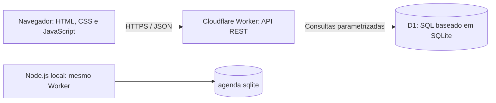

# Agenda telefônica

Aplicação web em português com API REST e SQLite. Interface responsiva, cadastro, edição, detalhes, exclusão confirmada, busca, grupos e favoritos.

## Executar localmente

Requisito: Node.js 22.13 ou superior (testado com 24.22.1). Nenhuma dependência npm.

```sh
node scripts/local.mjs
```

Abra http://127.0.0.1:5173. O arquivo `agenda.sqlite` será criado no diretório atual. Para outra porta: `PORT=8080 node scripts/local.mjs`. O servidor local escuta apenas em loopback. Copie o arquivo SQLite com a aplicação parada para fazer backup local. Não há sincronização automática entre os dados locais e os hospedados.

```sh
node --test scripts/api.test.mjs
node scripts/build.mjs
```

## API

| Método | Rota | Resultado |
|---|---|---|
| GET | /api/health | Saúde da conexão com o banco |
| GET | /api/contacts?q=ana | Lista e busca |
| GET | /api/contacts/:id | Detalhes |
| POST | /api/contacts | Cria (201) |
| PUT | /api/contacts/:id | Substitui os campos editáveis |
| DELETE | /api/contacts/:id | Exclui (204) |

POST e PUT usam `Content-Type: application/json` e o corpo completo:

```json
{"name":"Ana Exemplo","phone":"(11) 90000-0000","email":"ana@example.com","category":"Pessoal","company":"","notes":"","favorite":false}
```

Os campos de texto são obrigatórios no JSON; campos opcionais na interface usam string vazia. O telefone exige de 8 a 15 dígitos e aceita formatação. Categorias: Pessoal, Família, Trabalho e Serviços. A resposta contém `id` UUID, `created_at` ISO 8601 e `favorite` como inteiro 0/1. Erros: 400 validação/JSON, 403 origem, 404 recurso ausente, 405 método, 413 tamanho, 415 tipo de conteúdo, 500 falha interna. GET /api/health retorna 503 se o banco estiver indisponível.

```sh
curl http://127.0.0.1:5173/api/health
curl -X POST http://127.0.0.1:5173/api/contacts -H 'Content-Type: application/json' -d '{"name":"Ana Exemplo","phone":"11900000000","email":"","category":"Pessoal","company":"","notes":"","favorite":false}'
```

## Arquitetura



Banco: `contacts(id TEXT PK, name TEXT, phone TEXT, email TEXT, category TEXT, company TEXT, notes TEXT, favorite INTEGER, created_at TEXT)`. Migration: `drizzle/0000_contacts.sql`. Um contato pertence a um grupo fixo; grupos não são tabela separada.

## Hospedagem e nuvem

O Sites gerencia publicação privada, URL HTTPS, Worker e binding D1 `DB`. O Worker recebe requisições e serve a interface e API. O D1 fornece persistência SQL com semântica SQLite. Não há VM contratada, disco de VM, SKU de VM, bucket R2 ou arquivos de contatos no navegador. A execução é serverless; plano comercial, região efetiva, custo e quotas da conta não foram fornecidos pela plataforma e não são inventados neste projeto. Memória documentada dos Workers: 128 MB por isolate. Consulte as referências oficiais para limites e preços vigentes.

O acesso hospedado permanece privado, restrito ao proprietário pela plataforma. A API não implementa login próprio ou isolamento por usuário; todos os visitantes autorizados de uma eventual versão compartilhada acessariam a mesma agenda. Para uso multiusuário, adicione owner_id e autorização em cada consulta antes de ampliar o acesso.

O build gera `dist/server/index.js` como módulo Worker ESM. A publicação usa `.openai/hosting.json`, sincroniza o código via Git, aplica migrations e implanta a versão salva. A cópia ZIP não contém credenciais nem banco de dados.

## Validação e limitações

Teste automatizado do mesmo handler com SQLite real: CRUD, busca, telefone inválido, JSON inválido, origem externa, favorito, contato ausente e persistência após reabrir o banco. Capturas em `docs/` mostram a prévia local com dados fictícios. Não representam registros de produção. A agenda hospedada começa vazia. Não há paginação, importação, exportação, foto, backup manual pela interface ou testes de carga. A listagem carrega todos os contatos; uso previsto: agenda pequena.

Consultas parametrizadas evitam interpolar valores no SQL. A interface escapa conteúdo exibido, valida campos e trata falhas. Operações de escrita com Origin externo são rejeitadas. Há limites de corpo e campos. Essas medidas não substituem autenticação e autorização da plataforma.

## GitHub

Não foi criado repositório no GitHub: é necessário indicar a conta/repositório de destino. O repositório Git de hospedagem do Sites é separado do GitHub. Para enviar este pacote a um repositório vazio criado por você:

```sh
git init
git add .
git commit -m "Agenda telefonica com API REST e SQLite"
git branch -M main
git remote add origin https://github.com/SEU_USUARIO/agenda-telefonica.git
git push -u origin main
```

O endereço acima é um modelo, não um repositório existente. Ao publicar como um novo Site, remova o project_id deste pacote e registre uma identidade própria; não reutilize a identidade do Site original.

## Referências

- https://developers.cloudflare.com/d1/
- https://developers.cloudflare.com/workers/platform/limits/
- https://nodejs.org/docs/latest-v24.x/api/sqlite.html
